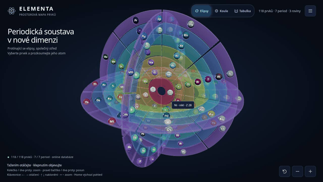
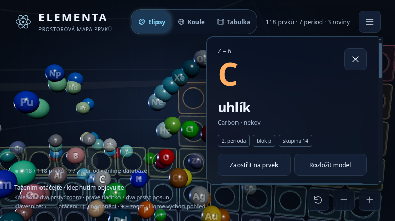

# ELEMENTA · Spatial Map of the Elements / Prostorová mapa prvků

Interactive 3D visualization of the periodic table in a single HTML file.  
118 elements · 7 periods · 3 intersecting planes (electron blocks s / p / d / f).

Interaktivní 3D vizualizace periodické soustavy prvků v jediném HTML souboru.  
118 prvků · 7 period · 3 protínající se roviny (elektronové bloky s / p / d / f).

  

> 🚀 **Online verze / Live 3D web app:** [https://school.vibemaker.cz/elementa/](https://school.vibemaker.cz/elementa/)  
> *(Aplikace běží přímo v prohlížeči, funguje offline a nevyžaduje instalaci)*

---

## English

### Features

- **Spatial model** — three ellipses share a center and lie in mutually perpendicular planes; color encodes the period, plane encodes the electron block.
- **Detail of every element** — symbol, atomic number, Czech and English names, ground-state electron configuration, electrons per shell, physical properties and data source.
- **Exploring relations** — highlight a period, group / series or a comparison pair (e.g. La ↔ Ac); guides for the group 3 convention (Sc–Y–Lu–Lr).
- **Search** — by symbol, name or atomic number.
- **Keyboard navigation** — arrow keys rotate and tilt, `+` / `-` zoom, `Home` resets the view.
- **Teaching mode** — five tasks in one panel: predict the period and block of an element, a four-question Socratic check (group 3 convention, Lr with a 7p electron, what the ellipses mean, how many elements period 6 has), a flat periodic table, progressive hints, and a short formative summary. The panel rolls up into a strip under the header so the model stays usable, and the camera turns to the element once it has been identified.
- **Flat periodic table** — the printed layout with sector-coloured sockets and glossy CPK spheres that match the 3D model; type in the field above it, `Enter` selects, arrow keys move between matches.
- **Appearance settings** — colors by periods / blocks / categories, labels, auto-rotation, band opacity, layer spacing, unfolding the planes, front / top / perspective views.
- **Czech / English** — language switch in the map and settings panel.

### Element Detail & Atomic Inspector

*Detailed element card with atomic structure, electron configuration, and physical properties.*

### Run

No installation, no build:

1. **Online:** Open [https://school.vibemaker.cz/elementa/](https://school.vibemaker.cz/elementa/)
2. **Local:** Download or clone the repository and open `index.html` in a modern browser (double-click is enough).
3. You need WebGL 2 and hardware acceleration.

The model and the embedded database **work offline**. If a connection is available, the app tries to update the element data online.

### Controls

| Action | Input |
|---|---|
| Rotate | drag with mouse / finger |
| Zoom | wheel / two fingers, `+` / `−` buttons |
| Pan | right button / two fingers |
| Element detail | click / tap a sector |
| Default view | home button at the bottom left |

### Data and Third-Party Licenses

- **Element database:** [Bowserinator / Periodic-Table-JSON](https://github.com/Bowserinator/Periodic-Table-JSON) · [CC BY-SA 3.0](https://creativecommons.org/licenses/by-sa/3.0/).  
  Embedded backup: 118 elements (28 September 2026); a selection of fields from the source. The Czech element names are the app’s own data. Data updates online.
- **3D library:** Three.js r180 + OrbitControls, embedded directly in `index.html` · MIT (© 2010–2025 the three.js authors · <https://threejs.org/license>).
- **Curriculum / facts:** [IUPAC – periodic table](https://iupac.org/what-we-do/periodic-table-of-elements/).

The ellipses are a map of the system, not electron trajectories. Sector sizes and distances between them are not physical quantities. For the heaviest elements some data are predicted.

### Educational Ecosystem & Related Apps

Why are related educational applications featured here? This project is part of an open didactic ecosystem created by a biology and computer science teacher. All tools in this suite share three foundational pedagogical principles:

- **Zero technical barrier:** Single-file SPAs with no build step, no backend server, and no setup. They run instantly on school computers, tablets, and phones directly in any modern browser, fully functional offline.
- **Exploratory & visual learning:** Complex spatial and logical structures (such as 3D atomic orbital planes in *Elementa* or algorithm loops in *CodeFlowChart*) are transformed into tangible, interactive models where students learn by direct exploration and immediate feedback.
- **Data privacy & student safety:** 100% offline-first architecture with local browser storage only — no pupil registration, no passwords, no user tracking, and no external telemetry.

**Explore related classroom tools:**
- **[CodeFlowChart](https://github.com/siberius/code-flowchart)** ([Online](https://school.vibemaker.cz/codeflowchart/)) — interactive flowchart simulator and algorithmic learning game for secondary school students (servicing ship HEFAISTOS).
- **[Kvíz](https://school.vibemaker.cz/kviz/)** — lightweight interactive quiz platform for classroom assessments with zero student data tracking.
- **[Study Prompts for Gemini Notebook](https://github.com/siberius/study-prompts)** — structured master prompt and 15 learning modes for guided self-study from primary source documents.

### Author

**Luděk Sušický** — biologist, secondary-school and university teacher of computing subjects

- E-mail: [ludek.susicky@gmail.com](mailto:ludek.susicky@gmail.com)
- X: [@ludeksusicky](https://x.com/ludeksusicky)
- LinkedIn: [Luděk Sušický](https://www.linkedin.com/in/ludek-susicky/)
- GitHub: [@siberius](https://github.com/siberius) — more educational projects and open-source applications

The app is an example of an SPA (Single Page Application) in a single HTML file.

### License

MIT © 2026 Luděk Sušický — see [LICENSE](LICENSE).  
The MIT license covers the app's own code. Three.js and OrbitControls have their own MIT license; the adopted database remains under CC BY-SA 3.0.

---

## Česky

### Co to umí

- **Prostorový model** — tři elipsy sdílejí střed a leží ve vzájemně kolmých rovinách; barva určuje periodu, rovina elektronový blok.
- **Detail každého prvku** — značka, protonové číslo, český i anglický název, elektronová konfigurace (základní stav), elektrony ve slupkách, fyzikální vlastnosti a zdroj dat.
- **Objevování souvislostí** — zvýraznění periody, skupiny / řady a srovnávací dvojice (např. La ↔ Ac); vodítka pro konvenci skupiny 3 (Sc–Y–Lu–Lr).
- **Vyhledávání** — podle značky, názvu nebo protonového čísla.
- **Klávesnice** — šipky otáčejí a naklánějí, `+` / `-` přibližují, `Home` vrací výchozí pohled.
- **Režim výuky** — pět úkolů v jednom panelu: předpověď periody a bloku prvku, sokratická kontrola ze čtyř otázek (konvence skupiny 3, Lr s elektronem 7p, význam elips, počet prvků 6. periody), plošná periodická tabulka, postupné nápovědy a krátká zpětná vazba. Panel se sroluje do lišty pod hlavičkou, aby šel dál používat model, a po určení prvku se kamera natočí na jeho kouli.
- **Plošná periodická tabulka** — tištěné rozvržení s lůžky ve fázové barvě sektoru a lesklými koulemi CPK, které odpovídají 3D modelu; do pole nad tabulkou se píše jako do běžné tabulky, `Enter` vybere, šipky jedou mezi nálezy.
- **Nastavení vzhledu** — barvy podle period / bloků / kategorií, popisky, automatické otáčení, průsvitnost pásů, rozestup vrstev, rozložení rovin, pohledy zepředu / shora / perspektiva.
- **Čeština / angličtina** — přepínač jazyka v mapě a nastavení.

### Karta prvku a atomový detail

*Informační karta prvku s atomovou strukturou, elektronovou konfigurací a fyzikálními vlastnostmi.*

### Spuštění

Nic se neinstaluje, žádný build:

1. **Online:** Otevři [https://school.vibemaker.cz/elementa/](https://school.vibemaker.cz/elementa/)
2. **Lokálně:** Stáhni nebo naklonuj repozitář a otevři `index.html` v moderním prohlížeči (dvojklik stačí).
3. Potřebuješ WebGL 2 a hardwarovou akceleraci.

Model i zabudovaná databáze **fungují bez internetu**. Je-li připojení k dispozici, aplikace se pokusí aktualizovat data prvků online.

### Ovládání

| Akce | Vstup |
|---|---|
| Otočení | tažení myší / prstem |
| Zoom | kolečko / dva prsty, tlačítka `+` / `−` |
| Posun | pravé tlačítko / dva prsty |
| Detail prvku | kliknutí / klepnutí na sektor |
| Výchozí pohled | tlačítko domů vlevo dole |

### Data a licence třetích stran

- **Databáze prvků:** [Bowserinator / Periodic-Table-JSON](https://github.com/Bowserinator/Periodic-Table-JSON) · [CC BY-SA 3.0](https://creativecommons.org/licenses/by-sa/3.0/).  
  Vložená záloha: 118 prvků (28. 9. 2026), výběr polí ze zdroje. České názvy prvků jsou vlastní data aplikace. Online se data aktualizují.
- **3D knihovna:** Three.js r180 + OrbitControls, vložené přímo do `index.html` · MIT (© 2010–2025 autoři three.js · <https://threejs.org/license>).
- **Kurikulum / fakta:** [IUPAC – periodická soustava](https://iupac.org/what-we-do/periodic-table-of-elements/).

Elipsy jsou mapou soustavy, nikoli drahami elektronů. Velikosti sektorů ani vzdálenosti mezi nimi nejsou fyzikální veličinou. U velmi těžkých prvků jsou některé údaje předpovězené.

### Vzdělávací ekosystém a související aplikace

Proč jsou zde uvedeny související výukové aplikace? Projekt je součástí uceleného otevřeného vzdělávacího ekosystému pro výuku přírodních věd a informatiky. Všechny tyto nástroje staví na třech klíčových didaktických pilířích:

- **Nulová technická bariéra:** Čisté jednostránkové aplikace (SPA) v jediném HTML souboru bez nutnosti sestavování (build), bez serverového backendu a bez instalace. Okamžitě fungují ve školních učebnách na libovolném žákovském zařízení (PC, tablet, telefon) a pracují plnohodnotně i bez připojení k internetu.
- **Názornost a objevování:** Abstraktní témata (3D prostorové uspořádání elektronových bloků v *Elementě* nebo krokování algoritmů v *CodeFlowChart*) převádějí do interaktivních vizuálních modelů, se kterými žáci přímo manipulují a experimentují.
- **Ochrana dat a soukromí žáků:** 100% offline-first přístup s ukládáním výhradně v lokálním prohlížeči — bez registrace, bez hesel, bez sledovacích skriptů a bez telemetrie.

**Související otevřené výukové projekty:**
- **[CodeFlowChart](https://github.com/siberius/code-flowchart)** ([Online](https://school.vibemaker.cz/codeflowchart/)) — interaktivní simulátor vývojových diagramů a algoritmizace pro žáky SŠ (servisní loď HEFAISTOS).
- **[Kvíz](https://school.vibemaker.cz/kviz/)** — bezpečné a svižné interaktivní testování do výuky bez sběru osobních údajů.
- **[Studijní prompty pro Gemini Notebook](https://github.com/siberius/study-prompts)** — knihovna master promptu a 15 výukových režimů pro řízené samostudium a reflexi z vlastních podkladů.

### Autor

**Luděk Sušický** — biolog, středoškolský a vysokoškolský učitel informatických předmětů

- E-mail: [ludek.susicky@gmail.com](mailto:ludek.susicky@gmail.com)
- X: [@ludeksusicky](https://x.com/ludeksusicky)
- LinkedIn: [Luděk Sušický](https://www.linkedin.com/in/ludek-susicky/)
- GitHub: [@siberius](https://github.com/siberius) — další vzdělávací projekty a otevřené aplikace

Aplikace je příkladem SPA (Single Page Application) v jediném HTML souboru.

### Licence

MIT © 2026 Luděk Sušický — viz [LICENSE](LICENSE).  
Licence MIT platí pro vlastní kód aplikace. Three.js a OrbitControls mají vlastní licenci MIT; převzatá databáze zůstává pod CC BY-SA 3.0.
